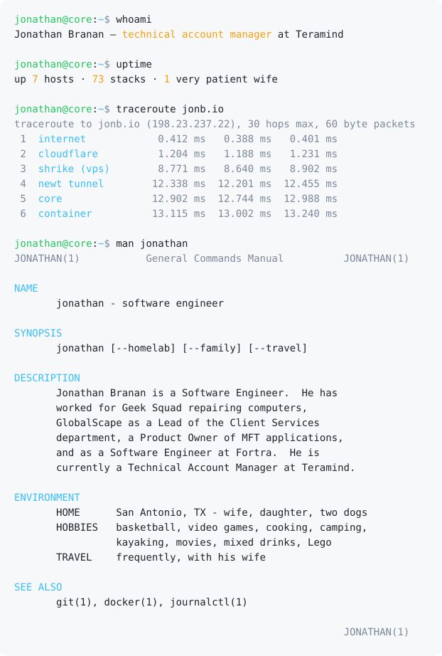

<!-- terminal:start -->
<picture>
  <source media="(prefers-color-scheme: dark)" srcset="terminal-dark.svg">
  
</picture>
<!-- terminal:end -->

<!-- status:start -->
● 78/78 services up · refreshed daily
<!-- status:end -->

[LinkedIn](https://www.linkedin.com/in/jonathanbranan/) · [GitHub](https://github.com/jonbranan) · [Résumé](https://s3.jonb.io/cdn/author/Resume.pdf) · [git.jonb.io](https://git.jonb.io/jblu) · [up.jonb.io](https://up.jonb.io)

## What I'm working on

<!-- working-on:start -->
- [**qbit-maid**](https://git.jonb.io/jblu/qbit-maid) — Qbittorrent cleaner that deletes torrents based on age, categories, domains and tags. · `v3.0.0`
- [**jonbio**](https://git.jonb.io/jblu/jonbio) — TypeScript · updated 59m ago
- [**seafile-backup**](https://git.jonb.io/jblu/seafile-backup) — backup seafile data and mariadb database
<!-- working-on:end -->

## Recent activity

<!-- activity:start -->
- [chore(projects): drop crane and apprise-client cards](https://git.jonb.io/jblu/jonbio/commit/6d833a65827acf6c801a0038bc5e96ec7d02c255) — jonbio · 59m ago
- [chore: 2.1.1](https://git.jonb.io/jblu/seafile-backup/commit/df6284ca2ce5ed0bf5c239b1f2d95c5249cb4001) — seafile-backup · 15h ago
- [fix: stable dump path so restic reuses a parent snapshot](https://git.jonb.io/jblu/seafile-backup/commit/5c009974c835a452b119a8cdf1de64ab335735d2) — seafile-backup · 16h ago
<!-- activity:end -->

## Recent pull requests

<!-- prs:start -->
- [chore(projects): drop crane and apprise-client cards](https://git.jonb.io/jblu/jonbio/pulls/15) — jonbio · 59m ago
- [feat: schedule with busybox crond instead of supercronic](https://git.jonb.io/jblu/seafile-backup/pulls/3) — seafile-backup · 17h ago
- [Rewrite as an online restic backup](https://git.jonb.io/jblu/seafile-backup/pulls/2) — seafile-backup · 1d ago
<!-- prs:end -->

## Recently completed

<!-- completed:start -->
- Give nanobot a dedicated least-privilege Linux user on each host · 1h ago
- set up mail in vikunja · 1d ago
- Decide on gating /v1/docs or rate limiting api.p.jonb.io · 1d ago
<!-- completed:end -->

regenerated daily by [tools/gen_readme.py](https://git.jonb.io/jblu/.profile)
